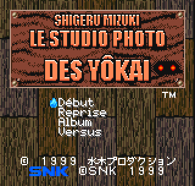
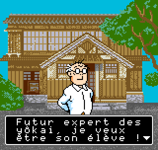

# Mizuki Shigeru no Youkai Shashinkan — traduction française

**Le Studio Photo des Yôkai de Shigeru Mizuki** (Neo Geo Pocket Color, SNK, 1999), entièrement
en français : dialogues, menus, objets, les 120 fiches de yôkai, écran titre et police latine redessinés.

<p align="center">
  
  
</p>

- **Partie 1 (français)** : jouer en français — le patch et comment l'appliquer.
- **Part 2 (English)** : the translation kit — tools and guide to translate the game into another language.

---

# Partie 1 — Jouer en français

## 1.1 Ce qu'il vous faut

Le patch : `patch/Mizuki_Shigeru_no_Youkai_Shashinkan_FR_v1.0.ips`.

**Votre propre** copie de la cartouche japonaise, non modifiée et sans en-tête. Aucune ROM n'est
fournie ici. Vérifiez-la :

| | ROM d'origine attendue |
|---|---|
| Nom (No-Intro) | `Mizuki Shigeru no Youkai Shashinkan (Japan).ngc` |
| Taille | 2 097 152 octets |
| CRC32 | `DDE08335` |
| SHA-1 | `8025d09368598951da94f8601729c16972b96830` |

Avec une autre ROM (déjà modifiée, autre version), le patch donnera un jeu cassé.

## 1.2 Méthode A — patch appliqué à la volée par l'émulateur (le plus simple)

L'émulateur applique le patch en mémoire à chaque lancement : la ROM d'origine n'est **pas modifiée**.
Il suffit de poser le fichier `.ips` à côté de la ROM, **sous le bon nom**, puis de lancer la ROM
japonaise normalement.

| Émulateur | Nom à donner au patch (même dossier que la ROM) |
|---|---|
| **NgpCraft Emulator** | `Mizuki Shigeru no Youkai Shashinkan (Japan).ips` |
| **RetroArch**, cœur **Beetle NeoPop** (`mednafen_ngp`) | `Mizuki Shigeru no Youkai Shashinkan (Japan).ips` |
| **Mednafen** | `Mizuki Shigeru no Youkai Shashinkan (Japan).ngc.ips` (extension `.ngc` comprise) |

Exemple de dossier (NgpCraft Emulator / RetroArch) :

```
Mizuki Shigeru no Youkai Shashinkan (Japan).ngc
Mizuki Shigeru no Youkai Shashinkan (Japan).ips
```

Remarques :
- **NgpCraft Emulator** : vérifié avec ce patch (la ROM obtenue en mémoire a le CRC32 `3E9C4177`).
  Un message confirme le patch au lancement. La ROM patchée étant en lecture seule, la sauvegarde
  va dans un fichier `.flash` à côté du jeu. Si le jeu est dans un `.zip`, le patch se pose à côté
  du `.zip` et porte le nom de la ROM qu'il contient.
- **RetroArch** : seul le cœur **Beetle NeoPop** sait appliquer un patch à la volée. Le cœur
  **RACE** ne le peut pas : il lit la ROM directement sur le disque. Avec RACE, utilisez la méthode B.
- Si l'écran titre reste en japonais, c'est que le patch n'a pas été trouvé : vérifiez le nom
  exact du fichier (majuscules, espaces, parenthèses) et que l'extension n'est pas cachée par Windows
  (`….ips.txt`).

## 1.3 Méthode B — créer une ROM française (pour la console, ou tout autre émulateur)

Pour jouer sur une vraie console (linker, flashcart) ou avec un émulateur sans patch à la volée,
fabriquez une fois pour toutes une ROM patchée :

- avec un outil IPS courant : **Rom Patcher JS** (dans le navigateur, rien à installer),
  **Flips** ou **Lunar IPS** ; choisissez la ROM japonaise, puis le `.ips`, et enregistrez le résultat ;
- ou avec l'outil fourni (Python 3) :

  ```
  python tools/ips.py apply "Mizuki Shigeru no Youkai Shashinkan (Japan).ngc" patch/Mizuki_Shigeru_no_Youkai_Shashinkan_FR_v1.0.ips Mizuki_FR.ngc
  ```

La ROM obtenue doit avoir ces empreintes :

| | ROM française obtenue |
|---|---|
| Taille | 2 097 152 octets (inchangée) |
| CRC32 | `3E9C4177` |
| SHA-1 | `ea2d96e368be4ff25d9e370bb671816fcf146a7e` |

Elle fonctionne sur émulateur comme sur console.

## 1.4 Points pas encore contrôlés à l'écran (v1.0)

Tout le texte est traduit et la ROM a été vérifiée automatiquement. Ces écrans n'ont toutefois
pas pu être regardés en jeu ; un retour est bienvenu s'ils débordent :
- l'**album** et la séance photo (noms de yôkai jusqu'à 15 caractères, fiches à 17 par ligne) ;
- le **distributeur de billets** (noms de destination jusqu'à 11 caractères) ;
- le **menu des objets** (« Talisman Flamme », 15 caractères) ;
- les **menus Oui/Non** (longueurs gardées identiques au japonais) ;
- le nom du joueur, dont la source n'a pas été étudiée.

La mention de copyright de l'écran titre (une image) est restée en japonais.

## 1.5 Mentions

- Traduction, police latine, logo et outils : **Tixul**, sous **licence MIT** (fichier `LICENSE`) :
  libre de les réutiliser, modifier et redistribuer en citant l'auteur.
- *Mizuki Shigeru no Youkai Shashinkan* © 1999 SNK / Mizuki Productions. Ce projet de fans n'est
  ni affilié ni approuvé par les ayants droit. Il ne contient **ni ROM, ni BIOS, ni texte
  ou graphisme d'origine** : le patch ne contient que les octets modifiés.

---

# Part 2 — Translation kit (English)

This folder also contains everything needed to translate the game into **another
Latin-alphabet language**. You only edit text files; the tools handle the ROM (text relocation,
pointers, font, title logo) and refuse to build while a rule is broken.

| Folder | Content |
|---|---|
| `lang/fr/` | the French translation (text files) and its settings (`lang.py`) — use it as your template |
| `tools/` | build the translated ROM and the IPS patch for any language |
| `patch/` | the released French patch |
| `screenshots/` | the two screenshots shown at the top of this file |
| `FORMAT.md` | technical notes on the ROM: encoding, pointers, font, title screen, constraints, French glossary (in French) |

## 2.1 Requirements
- Python 3.9 or later, and **Pillow** (`pip install pillow`).
- The original Japanese ROM (hashes in section 1.1: CRC32 `DDE08335`). The tools check it and
  refuse any other file.
- A TrueType font **you are allowed to use** for the title logo (the French version uses
  "Impact", a Windows system font; it is not included).

## 2.2 Steps
1. **Copy** `lang/fr` to `lang/<code>` (e.g. `lang/es`).
2. **Edit** `lang/<code>/lang.py`:
   - `TITLE_LINES`: the 3 lines of the title logo, with font and size;
   - `MENU`: the 4 title-menu entries (limited widths: 32, 40, 32 and 48 pixels; the tool tells
     you if a word does not fit);
   - `EXTRA_GLYPHS`: letters missing from the font (ñ, ü, ß, ã…), drawn as 5×8 bitmaps;
   - `DESTINATIONS`: city names shown by the ticket machine.
3. **Build a reference script** (Japanese + French under each block) from *your own* ROM:
   ```
   python tools/extract.py --rom GAME.ngc --out script_ja_fr.txt --ref fr
   ```
   The Japanese script is not distributed (it is the game's text): everyone extracts it from
   their own cartridge.
4. **Translate** the `.txt` files in `lang/<code>/`, replacing the French lines. See the rules below.
5. **Regenerate** the automatic files:
   ```
   python tools/tarifs.py   --rom GAME.ngc --lang <code>
   python tools/doublons.py --rom GAME.ngc --lang <code> --range 2C800 2F000 --out doublons_2C800.txt
   python tools/doublons.py --rom GAME.ngc --lang <code> --range 2F000 30800 --out doublons_2F000.txt
   ```
   (`doublons` reuses your translation for the town scenes the game repeats; run it again after
   translating the originals.)
6. **Build** the ROM and the patch, then test in an emulator:
   ```
   python tools/build.py --rom GAME.ngc --lang <code> --ips
   python tools/etat.py  --rom GAME.ngc --lang <code>          (progress report)
   ```
   Output: `out/<code>.ngc`, `out/<code>.ips` and a title-screen preview `out/<code>_titre.png`.
   ⚠️ Distribute the **.ips** only, never the ROM.

## 2.3 Translation file rules

```
# comment
@24738                  <- do not touch: address of the message in the ROM
Femme                   <- speaker name
Tiens, encore
chez le maître ?{FD}
Tu es tenace !{FF}
```

- **One line in the file = one line on screen.** Keep **the same number of lines** as the
  original, and the `{XX}` codes at the same places (same order).
- **17 characters max** per dialogue line; **3 lines** per page under the speaker name.
- **Speaker name: 6 characters max** (longer names get overwritten on the next page).
- A line holding a single space is an intended blank line: keep it.
- `{F2}` = player name, `{F3}`/`{F4}` = numbers inserted by the game.
- `{FD}` next page, `{FC}` speaker change (the next line is a name), `{FF}` end,
  `{F7}`/`{F6}` waits. `{F5}{xx}`, `{F8}{xx}`, `{F9}{xx}`, `{FA}{xx}`: keep the `{xx}` byte that follows.
- **Cursor menus** (`menus.txt`): spaces mark the cursor slots. Keep the lengths **exactly**.
- Digits `0-9` are available; `{79}` = ¥, `{7D}`/`{7E}` = A/B buttons.
- Characters available out of the box:
  `a-z A-Z é è ê ë à â ù û î ï ô ç œ Ç ' : ; … ( ) , . « » - ? !`.
  No accented capitals except Ç: add what you need through `EXTRA_GLYPHS`.

`build.py` checks everything (structure identical to the Japanese, widths, characters, chained
messages) and lists **all** errors at once.

Tip: adapt rather than translate word for word. Each line must make sense on its own, spoken by
that character. Villagers' rumours are **hints** (place, time of day, terrain): keep them exact.
The French glossary is at the top of the text files and in `FORMAT.md`; the speaker names and
the comments in the French files explain the context of each scene.

## 2.4 Credits and legal
- French translation, Latin font, logo and tools: **Tixul**, released under the **MIT License**
  (see `LICENSE`): you may reuse, modify and redistribute them, keeping the copyright notice.
- *Mizuki Shigeru no Youkai Shashinkan* © 1999 SNK / Mizuki Productions. This fan project is not
  affiliated with or endorsed by the rights holders. It contains **no ROM, no BIOS, and no
  original game text or graphics**: patches only hold the modified bytes, and the Japanese script
  is only obtained by extracting it from your own ROM.
